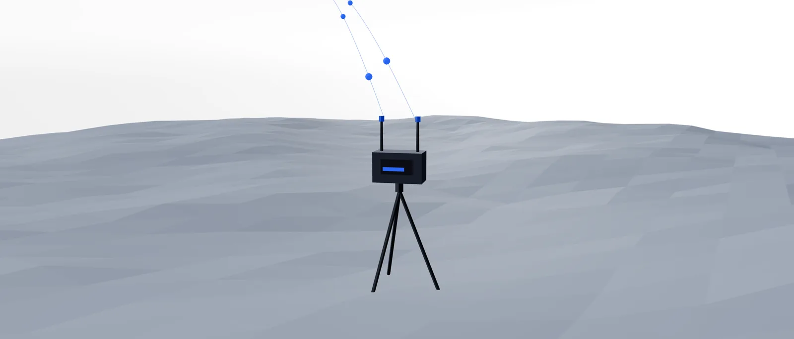
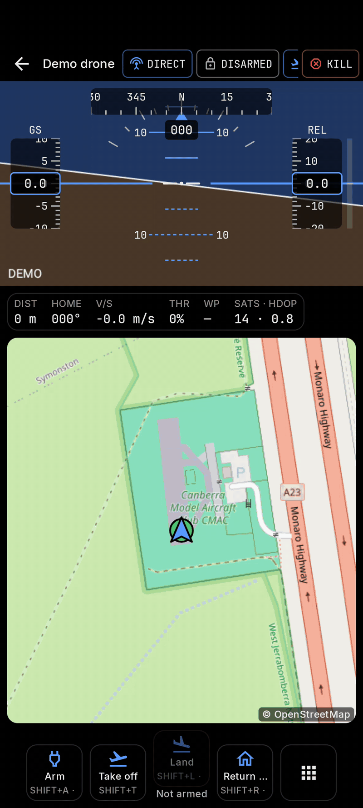
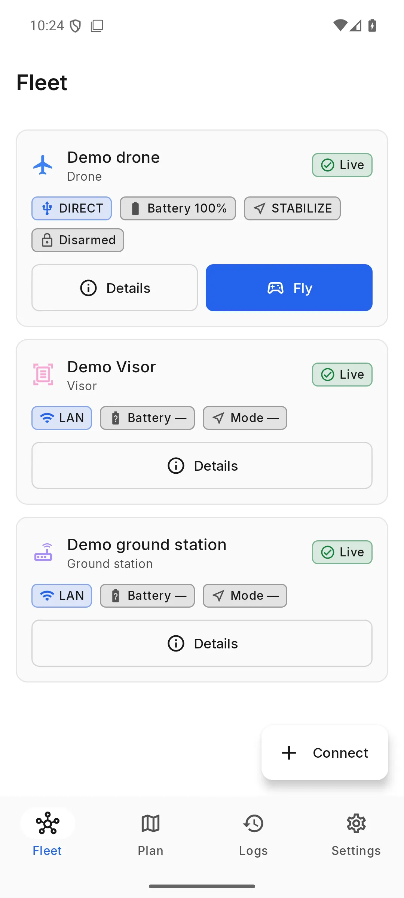
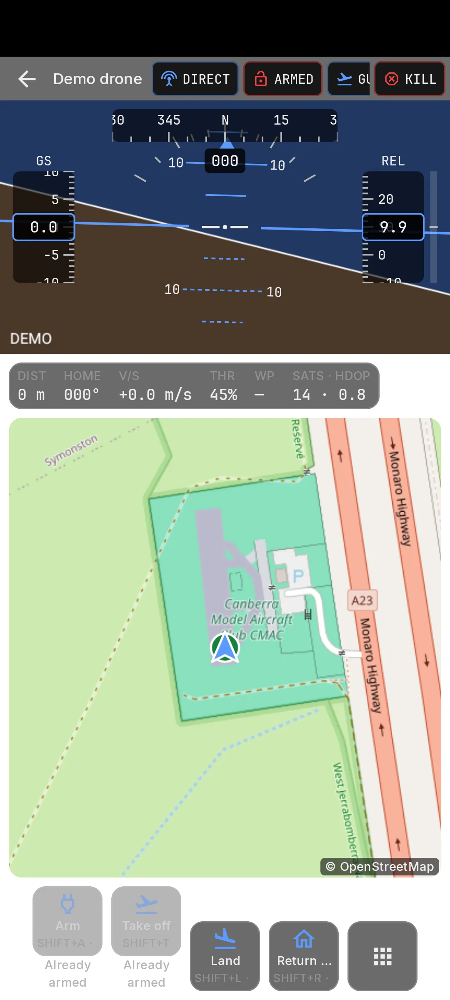
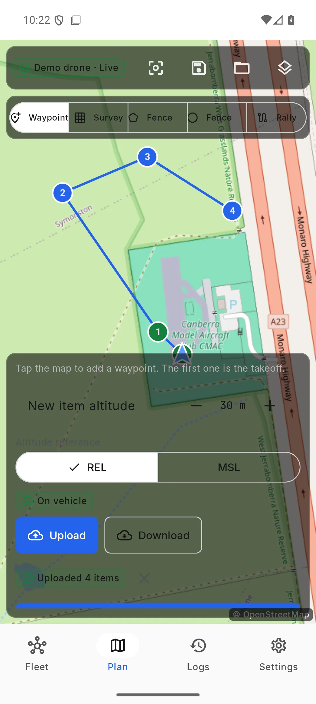
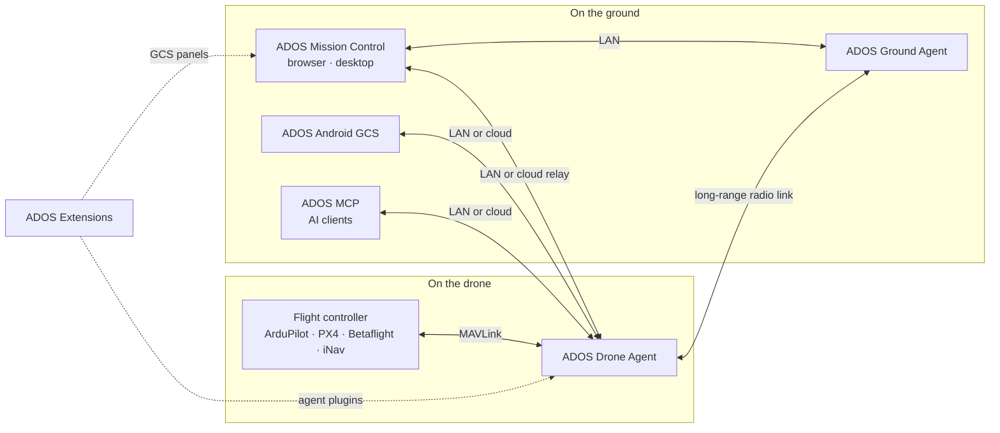

<p align="center">
  <a href="https://altnautica.com">
    <picture>
      <source media="(prefers-color-scheme: dark)" srcset=".github/assets/brand/ados-lockup-dark.svg">
      
    </picture>
  </a>
</p>
<h1 align="center">ADOS Android GCS</h1>
<p align="center"><em>Native Android ground control for ADOS drones, ground nodes and flight controllers.</em></p>
<p align="center">
  <a href="LICENSE"></a>
  <a href="https://kotlinlang.org"></a>
  
  <a href="https://discord.gg/uxbvuD4d5q"></a>
</p>
<p align="center">
  <strong><a href="https://github.com/altnautica/ADOSMissionControl">Mission Control</a></strong> |
  <strong><a href="https://github.com/altnautica/ADOSDroneAgent">Drone Agent</a></strong> |
  <strong><a href="https://github.com/altnautica/ADOSAndroidGCS">Android GCS</a></strong> |
  <strong><a href="https://github.com/altnautica/ADOSExtensions">Extensions</a></strong> |
  <strong><a href="https://github.com/altnautica/ADOS-MCP">MCP</a></strong> |
  <strong><a href="https://github.com/altnautica/ADOSDroneAgent/tree/main/crates#published-crates">Rust crates</a></strong> |
  <strong><a href="https://docs.altnautica.com">Docs</a></strong> |
  <strong><a href="https://altnautica.com">Website</a></strong> |
  <strong><a href="https://discord.gg/uxbvuD4d5q">Discord</a></strong>
</p>
<p align="center">
  <a href="https://docs.altnautica.com/android/overview">Docs</a> ·
  <a href="https://github.com/altnautica/ADOSAndroidGCS/issues">Issues</a>
</p>

<p align="center">
  <picture>
    <source media="(prefers-color-scheme: dark)" srcset=".github/assets/scenes/ground-node-dark.webp">
    
  </picture>
</p>

ADOS Android GCS is a native ground control station written in Kotlin with Jetpack Compose, for phones, tablets and handheld controllers running Android 10 (API 29) or later, in either screen orientation. It reaches an ADOS Drone Agent on the LAN, a flight controller directly over USB, UDP or TCP, and your fleet through the opt-in cloud.

## Quick start

Requirements: JDK 17, Android SDK platform 37.0 (`platforms;android-37.0`), build-tools 37 and NDK 26.3.11579264 (for the radio modules). The app compiles against API 37 and targets API 36.

```bash
git clone https://github.com/altnautica/ADOSAndroidGCS.git
cd ADOSAndroidGCS
cp local.properties.example local.properties   # optional build-time endpoints
./gradlew assembleDebug testDebugUnitTest lintDebug
```

The debug APK lands in `app/build/outputs/apk/debug/`. See the [install guide](https://docs.altnautica.com/android/install) for side-loading it onto a device.

## In the app

<table>
  <tr>
    <td width="50%">
      
      <p align="center"><a href="https://docs.altnautica.com/android/overview">Fly from the cockpit</a></p>
    </td>
    <td width="50%">
      <picture>
        <source media="(prefers-color-scheme: dark)" srcset=".github/assets/screens/android-home-dark.webp">
        
      </picture>
      <p align="center"><a href="https://docs.altnautica.com/android/overview">Every node in one fleet list</a></p>
    </td>
  </tr>
  <tr>
    <td width="50%">
      <picture>
        <source media="(prefers-color-scheme: dark)" srcset=".github/assets/screens/android-hud-dark.webp">
        
      </picture>
      <p align="center"><a href="https://docs.altnautica.com/android/overview">Cockpit flight display</a></p>
    </td>
    <td width="50%">
      <picture>
        <source media="(prefers-color-scheme: dark)" srcset=".github/assets/screens/android-map-dark.webp">
        
      </picture>
      <p align="center"><a href="https://docs.altnautica.com/android/overview">Plan and upload missions</a></p>
    </td>
  </tr>
</table>

## How ADOS fits together



ADOS Ground Agent is the Drone Agent running its ground-station profile.

| Repo | Runs on | What it does | Link |
|---|---|---|---|
| ADOS Mission Control | Browser, desktop (Electron) | Ground control station: FC setup, mission planning, flight, 3D simulation, fleet | [ADOSMissionControl](https://github.com/altnautica/ADOSMissionControl) |
| ADOS Drone Agent | Companion computer on the drone, or a ground node | Onboard agent: MAVLink routing, HD video, long-range radio link, plugins, remote control | [ADOSDroneAgent](https://github.com/altnautica/ADOSDroneAgent) |
| ADOS Android GCS | Android phones and tablets | Native ground control app for agents on the LAN, direct flight controllers and the cloud | [ADOSAndroidGCS](https://github.com/altnautica/ADOSAndroidGCS) |
| ADOS Extensions | Drone Agent and Mission Control | First-party signed plugins, each with an agent half and a GCS half | [ADOSExtensions](https://github.com/altnautica/ADOSExtensions) |
| ADOS MCP | Your machine | Model Context Protocol server that lets AI clients operate ADOS drones under scopes and a safety gate | [ADOS-MCP](https://github.com/altnautica/ADOS-MCP) |
| Documentation | docs.altnautica.com | Public docs for every ADOS product | [Documentation](https://github.com/altnautica/Documentation) |

## Link families

The app reaches nodes through every ADOS link family. Each family is a separate module behind the shared contracts in `:core:model`:

- **Agent on the LAN**: REST on port 8080, MAVLink over WebSocket on port 8765, WHEP video, ground-station event streams, and the ground-station relay to the drones it carries.
- **Direct flight controller**: USB serial, UDP and TCP.
- **Cloud** (opt-in): sign-in, MQTT v5 control, WebRTC over MQTT and the fMP4 video relay.
- **Phone radio**: a receive-only WFB link through a USB radio dongle attached to the phone.

## Toolchain

Gradle 9.6, Android Gradle Plugin 9.4 with built-in Kotlin, Kotlin 2.4, KSP, Hilt, Compose (BOM 2026.09), Material 3 adaptive, Navigation 3, Room, DataStore, OkHttp 5 with kotlinx.serialization, MapLibre Native and the WebRTC Android SDK. Versions live in `gradle/libs.versions.toml`; shared build configuration lives in the `build-logic/` convention plugins.

## Modules

| Module | Purpose |
|---|---|
| `:app` | Activity, application, navigation graph, dependency injection root |
| `:core:model` | Pure Kotlin contracts shared by every module (nodes, reaches, transports, telemetry, commands, skills, video, alerts) |
| `:core:designsystem` | Theme, generated design tokens, bundled fonts, base components |
| `:core:mavlink` | MAVLink codecs generated from the XML definitions, framing, signing |
| `:core:link` | Vehicle model, MAVLink protocols, USB/UDP/TCP/demo transports |
| `:core:data` | Settings storage and the encrypted credential vault |
| `:core:database` | Room database: flight sessions, tlog index, saved plans |
| `:core:agent` | ADOS agent REST/WebSocket client, discovery, pairing, Wi-Fi join |
| `:core:video` | WHEP client, renderers, stream descriptors, H.264 decode path |
| `:core:map` | MapLibre wrapper, tile providers, offline packs |
| `:core:skills` | Skill registry, activation pipeline, bindings, input routing |
| `:core:extensions` | Extension manifests, extension skills and parameters, WebView bridge |
| `:core:cloud` | Cloud sign-in, fleet, commands, MQTT and cloud video |
| `:radio:rx` | WFB receive path for the phone radio |
| `:radio:usb` | USB radio service running in its own process |
| `:feature:*` | Connect, fleet, node detail, settings, cockpit, plan, configure, logs |
| `:baselineprofile` | Baseline profile generator for app start and the cockpit |

`core/designsystem/src/main/kotlin/com/altnautica/gcs/core/designsystem/tokens/AdosTokens.kt` is generated from the shared ADOS design tokens and is never edited by hand.

## Community

Questions and show-and-tell go in [Discord](https://discord.gg/uxbvuD4d5q). Bugs and feature requests go in [Issues](https://github.com/altnautica/ADOSAndroidGCS/issues).

## Contributing

Issues and pull requests are welcome. Run `./gradlew assembleDebug testDebugUnitTest lintDebug` before opening a pull request, and keep contributions technical and free of private or third-party content.

## License

GPL-3.0-only. See [LICENSE](LICENSE). Third-party components and their licences are listed in [THIRD_PARTY_NOTICES.md](THIRD_PARTY_NOTICES.md).
